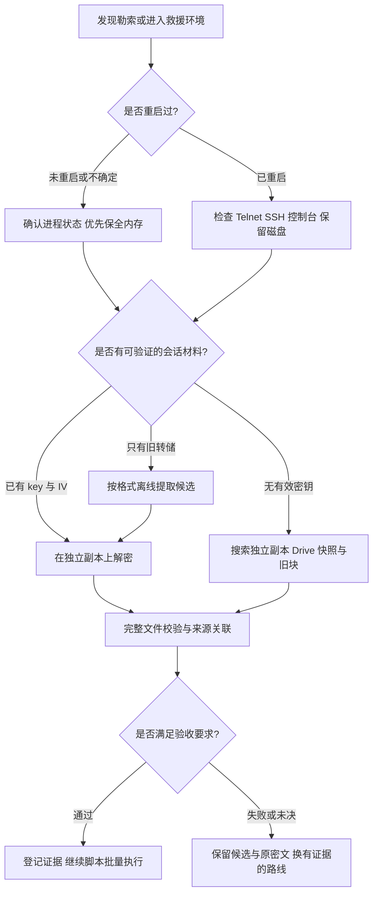

# Synology Ransomware Recovery

群晖勒索综合恢复 Skill · 调用名：`$synology-ransomware-recovery`

**根据现场状态选择恢复路线，由脚本批量恢复和校验，在独立存储上验证结果并显示进度；agent 处理异常与新线索。**

本技能不自动重启系统，不运行恶意样本，不写回受灾卷。进度与交付报告分别列出已验证结果、候选、部分恢复、失败及未验证项；已验证结果注明具体检查、证据与覆盖范围。

面向群晖 DSM、黑群晖及 Linux NAS 的 C3RB3R / `.L0CK3D` 勒索事件。将现场保全、内存与密钥分析、副本解密、Telnet 救援、Btrfs 旧数据块、Synology Drive 与备份搜索整理为一个可复用的 Codex Skill。

> **重启后提示“重新安装 DSM”，先检查 Telnet、SSH 或可信控制台入口。** 这个提示不能证明数据盘已空，不要为了取得管理入口直接点击安装向导。
>
> **尚未重启时，优先保住易失密钥。** 不贸然关机、重启、升级或终止加密进程；先确认进程身份、暂停加密活动并核对状态，再尽快保全内存。

技能入口：[SKILL.md](SKILL.md) · 批量执行：[脚本与异常处理](references/scripted-batches.md) · 内存密钥：[统一检查](references/memory-key-check.md) · 实时进度：[使用说明](references/live-progress.md) · 恢复验收：[验证标准](references/export-verify.md) · 致谢：[项目与贡献](#致谢) · 第三方来源：[版权与接入说明](THIRD_PARTY_NOTICES.md)

## 先看你的情况

| 当前状态 | 现有材料 | 优先路线 |
|---|---|---|
| 未重启，加密器仍存活 | 尚无 key / IV | 确认并暂停加密进程，保全进程或整机内存；匹配样本后提取会话材料 |
| 未重启，进程已退出或 OOM | 尚无可用密钥 | 尽早保存仍可取得的 RAM 和实际使用过的 swap，同时检查副本与快照 |
| 已重启 | 有重启前保存的 RAM / 进程 dump | 按真实转储格式离线分析，不把新内存当作旧现场 |
| 已重启 | 有同会话 AES key + IV 或 key.sys | 无需重新在线扫描，在独立密文副本上验证并解密 |
| 已重启，DSM 提示安装或重置 | 无旧内存、无有效密钥 | 检查 Telnet / SSH / 控制台；只读调查存储层，优先 Drive、副本、快照与 Btrfs 旧块 |
| 任一状态 | 只有 AES key，或只有 IV | 材料不完整，寻找缺失部分；不能补零或混用其他会话材料 |
| 任一状态 | 每文件 ChaCha key + nonce | 另行确认目标文件、算法与计数器规则，不能当作会话 AES 主材料 |
| 任一状态 | 公共密钥候选、未知变种、重复加密 | 先做样本与完整文件验证；相同后缀或 marker 不证明密钥通用 |

**重启与未重启都检查可用密钥线索。** 已重启时优先旧内存、key.sys / key / IV 和实际 swap 残留；没有旧材料时如实登记无法评估，不把新 RAM 当作旧现场。

**重启不使已经保存的正确 key / IV 失效；没有密钥，也不代表没有其他恢复路线。** 实际能恢复哪些文件，需要逐项验证，不能从表格直接推定成功率。



## 集成了什么

| 模块 | 本技能提供的能力 |
|---|---|
| 现场保全 | 依据重启历史、进程身份、设备类型和管理链路选择保全方式 |
| 救援入口 | 沿用已提供的 SSH 或 Telnet；入口未知或失效时检查指定主机端口，区分连接、登录与存储状态 |
| 内存密钥检测 | 保存的进程映射、QEMU 与字节结构扫描；区分未评估、未找到、候选和指定文件验证通过 |
| 密钥材料 | 区分 AES key / IV、raw48、Solar key.sys、每文件 key / nonce 和公共候选 |
| 副本解密 | 绑定已审阅的文件格式与会话 marker，拒绝覆盖、未知模式及不完整尾部 |
| Solar 工具接入 | 整理在线 PID 扫描、旧 dump 分析和已有会话材料三个入口及适用限制 |
| Btrfs 恢复 | 自检、代数采样、旧 extent 规划、普查、导出与适用的块校验和检查 |
| 副本与备份搜索 | 优先调查 Drive 仓库、独立原件、共享快照、ABB 与 VMM 的实际数据关系 |
| 脚本批量流水线 | 保存的 Btrfs TAR 一次完成归档检查、导出与并行校验；保存检查点并生成异常清单 |
| 实时进度 | 阶段、文件、处理量、速度、ETA、候选检查和去重验收计数；终端与本地网页显示 |
| 完整验收 | 区分传输一致、源块校验、完整格式检查、历史原件对照与业务验收 |

ABB、Drive、未挂载阵列及客体文件系统的复杂解析是**有条件的恢复流程**，不是已经覆盖所有版本的一键工具。遇到不同布局，需要按现场验证或适配。

## 安装与调用

### 安装为 Codex Skill

将本目录复制到技能目录，保持名称为 `synology-ransomware-recovery`：

```text
~/.codex/skills/synology-ransomware-recovery/
├── SKILL.md
├── README.md
├── agents/
├── scripts/
├── references/
└── assets/
```

Windows 默认位置为 `%USERPROFILE%\.codex\skills\synology-ransomware-recovery`。如果配置了 `CODEX_HOME`，使用其下的 `skills` 目录。更新或改名时先将原版本备份到技能目录之外；技能目录只保留当前版本，避免重复发现或嵌套成两层。

在 Codex 中调用：

```text
$synology-ransomware-recovery
```

也可以把 [SKILL.md](SKILL.md) 交给支持读取本地技能的助手。技能说明负责选择路线，脚本负责执行已支持且经过验证的操作。

### 推荐起始请求

```text
使用 $synology-ransomware-recovery 帮我评估群晖勒索恢复。
NAS IP：填写当前地址；发现时间：填写时间；是否重启：填写情况。
已有材料：RAM / 进程 dump / key.sys / key 与 IV / 均无。
优先目录：填写需要恢复的目录；独立目的盘：填写位置。
先保全现场并做只读检查，再在独立副本验证。
脚本批量恢复和校验，agent 只处理异常与新线索，不反复读成功日志或拆小批次。
显示实时进度，清楚区分候选、完整验证结果和未恢复项。
不要自动重装、初始化、修复源卷或写回受灾池。
```

### 运行环境

| 工具 | 运行位置与要求 |
|---|---|
| 本地脚本与进度查看器 | 干净分析主机；建议 Python 3.10+ |
| 副本解密 | 本地 Python，另需 `numpy`、`cryptography` |
| Btrfs 现场工具 | Linux / DSM；Python 3.6+、必要的 root 权限和受支持的存储映射 |
| 图片与音视频验证 | 按格式选择 Pillow、pillow-heif、ffmpeg 等可选工具 |
| Solar 二进制 | 与样本匹配的 Linux x86-64；不能在 Windows 直接执行 |

依赖装在干净分析机，不能为了运行工具向受灾数据卷安装套件。不是所有文件类型都需要安装全部可选依赖。

## 常用操作

以下在本技能根目录执行，路径需替换成现场已授权的实际位置。进度、日志、候选和最终文件都写到**源存储池以外**。新输出与进度文件应尚不存在。

### 批量恢复与校验

已保存的 Btrfs 导出 TAR 可连续运行：

```sh
python -X utf8 scripts/recovery_batch.py --export export.tar --output new-batch-recovery --workers 2 --known independent-originals --progress-file new-batch-progress.json
```

没有独立原件时省略 `--known`。脚本完整检查归档、解包、并行校验，并生成 `batch-state.json` 与仅包含未决源文件的 `_exceptions.jsonl`；普通文件失败不阻断其他任务。已完成批次不重复启动，校验中断后可 `--resume`，当前 SHA 仍核对，只复用字节未变的成功解码。

当前流水线针对保存的 Btrfs 导出格式，其他路线使用各自已审阅执行器按清单批量运行。详细分工、断点条件和验收范围见 [脚本批量执行](references/scripted-batches.md)。

### 1. 使用或检查救援入口

你提供 SSH 或 Telnet 都可以。沿用当前可用、已授权的协议、端口和账号，不要求先切换协议、开启 SSH 或重装 DSM。两者都可执行 shell 状态检查和恢复作业；文件传输按实际通道能力验证。入口未知或连接失效时，再检查指定主机端口。

```sh
python -X utf8 scripts/probe_rescue_ports.py --host 192.168.200.2 --output new-ports.json
```

只做指定主机的有界 TCP 连接测试，不登录、不猜口令、不启用服务。`192.168.200.2` 是私有地址示例，使用时改成当前 NAS 地址；端口开放不证明服务身份或设备可信。

### 2. 检查内存中的密钥线索

先保全内存，再对保存的副本检查。进程映射集合可这样运行：

```sh
python -X utf8 scripts/memory_key_check.py --input saved-process --format process-maps --capture-origin not-rebooted --output new-private-key-check --progress-file new-memory-progress.json
```

重启前的旧 dump 同样检查，标注 `--capture-origin pre-reboot`。QEMU 页表提取须明确 `--format qemu` 与匹配的 profile；raw、LiME 和 ELF 字节扫描仅搜索支持的结构，不把没有命中解释成所有内存都没有密钥。

输出分别显示 `not_assessed`、`not_found`、`candidate_found` 或 `verified_for_file`。候选可结合独立密文副本、已审阅 marker、已知原件 SHA 或完整归档验证；仅尾部一致仍是候选。真实 key / IV 只保存到私有文件，详细命令与范围见 [内存密钥检查](references/memory-key-check.md)。

### 3. 准备已有 key / IV

私有 JSON 使用 `aes_key_hex`（64个十六进制字符）与 `aes_iv_hex`（32个十六进制字符）字段；真实材料保存在私有文件，不放命令行或聊天。

```sh
python -X utf8 scripts/prepare_session_key.py --input private-key.json --format json --output new-master.bin
python -X utf8 scripts/prepare_session_key.py --input key.sys --format solar-key-sys --output new-master.bin
```

输出为已识别样本使用的 `IV16 + AES-key32`，共48字节。格式与长度合格仍不代表材料正确；单有 AES key 或单有 IV 不足以执行此流程。更多类型见 [密钥材料说明](references/key-materials.md)。

### 4. 单文件副本解密

先检查尾部并确认样本适配，再显式绑定该会话的 marker：

```sh
python -X utf8 scripts/inspect_footer.py --input-copy copies/example.tar.gz.L0CK3D
```

```text
python -X utf8 scripts/decrypt_copy.py --copy-root copies --input-copy copies/example.tar.gz.L0CK3D --master-file new-master.bin --expected-marker 已检查的8位十六进制标记 --output new-example.tar.gz --progress-file new-decrypt-progress.json
```

有同版本独立原件摘要时加入 `--expected-sha256`。成功写出后继续做完整文件检查；**错误 IV 可能通过重复 nonce 检查**，不能只凭密钥记录可解析就宣布恢复成功。

### 5. 导出与验证

```sh
python -X utf8 scripts/c3r_local.py extract export.tar new-candidates --progress-file new-export-progress.json
python -X utf8 scripts/c3r_local.py validate new-candidates --progress-file new-validation-progress.json
python -X utf8 scripts/verify_backup.py new-example.tar.gz --progress-file new-archive-progress.json
```

`extract` 使用新目录，拒绝覆盖、重复成员、链接与越界路径。归档检查读取完整 gzip / TAR 数据流，并检查 CRC、结束块与尾部。格式未检查的文件单列未验证，已知原件不匹配不计为通过。

### 6. 打开实时进度

在另一个本地终端查看一个或多个阶段：

```sh
python -X utf8 scripts/recovery_progress.py watch new-decrypt-progress.json new-export-progress.json new-archive-progress.json
```

生成自动刷新的本地网页：

```sh
python -X utf8 scripts/recovery_progress.py watch new-export-progress.json new-archive-progress.json --html new-live-progress.html
```

打开 `new-live-progress.html`，并保持查看器运行。默认每2秒刷新，支持 `--interval` 调整；停止查看器不停止恢复任务。

**示例显示，非实际恢复状态：**

```text
[导出落盘] running 40.0% | 40.00/100.00 GiB | 80.0 MiB/s | 预计剩余 768秒
阶段文件 120/300 (40.0%)  格式验证 0  已验收 0  失败 0
最近数据更新：2026-10-31 20:00:00（北京时间）
```

阶段百分比以实际工作量计算，总量未知时不猜百分比或 ETA。多进程校验按完成顺序更新，同一原文件的 prev / next 候选不重复累计最终验收数。网页显示真实数据更新时间，刷新页面不会伪造后台进展。详见 [实时进度说明](references/live-progress.md)。

## 什么算恢复成功

| 已取得的证据 | 可以作出的结论 |
|---|---|
| 导出摘要与独立本地回读摘要一致 | 传输与落盘一致；不单独证明事故前原文正确 |
| 相关源块与有效校验和记录全部一致 | 已检查块完整；仍需对应文件/历史版本的映射关联 |
| 完整归档检查或全文件解码通过 | 通过所列格式测试；业务可用性另行验收 |
| 与独立同版本原件完整 SHA-256 或逐字节一致 | 该文件精确恢复 |
| 在干净环境完成数据库/应用还原和检查 | 通过所列业务验收 |
| 文件头、预览、语法解析或部分解包有效 | 有限证据，仍是候选或部分结果 |

`exact` 是映射分类，退出码0是程序状态，读取100%是阶段进度，均不能单独代表完整恢复。缺段、填零、推测与跳错解包文件分别保存；用户只接受完整结果时，不将它们放进最终验收目录。

## 重要边界

- **原件保留。** 不删除密文、快照、回收站或源 RAID 成员，不运行 defrag、balance、repair、TRIM 或清理来试验恢复。
- **独立目的盘。** 同一受灾池里的另一个卷或 RAID1 的另一成员，不是安全的恢复目的盘。普通密文文件副本也不保留 Btrfs 旧 extent。
- **按样本适配。** 固定地址、588字节尾部、ChaCha8、会话 marker、QEMU 映射都要核对，不适用于所有 `.L0CK3D` 文件。
- **按工具能力处理。** 附带 Btrfs 规划器对分段参数和条带布局有限制；未挂载救援卷不能为跑 preflight 而直接组装/挂载源盘。参数20不能假称参数10规划器已支持。
- **Solar 保留源文件。** 官方工具默认解密成功可能删除密文；恢复时使用独立副本与 `--keep-source`，不以 `--force` 绕过冲突。`--dump-input` 参数存在不代表兼容所有 dump 格式。
- **业务单独验收。** 完整容器归档不一定包含 bind mounts；大量客体文件恢复不等于原虚拟机可启动，也不能据此宣称完整 OVA 已恢复。

## 案例带来的改进

技能包含一个已重启、没有有效密钥的 NAS 救援案例：通过既有 Telnet 入口只读调查未挂载存储，旧块路线仍有缺口时，继续在 Synology Drive 仓库寻找可达副本，最终用完整映射、源块校验和、gzip / TAR 全流验证及独立回读确认大备份完整。

这个案例说明：**旧块路线失败后仍应检查其他可验证来源；重启后的安装提示也不等于必须重装才能读取数据。** 案例中的设备号、代数、偏移和成功范围不能当成其他 NAS 的默认值。公开整理版仅保留必要技术经验，不包含真实密钥、内存转储、完整会话或用户恢复数据。

## 验证状态

截至2026年11月1日，已完成：

- 13项恢复辅助回归：密钥格式、完整副本解密、错误 IV、归档截断、陈旧摘要、路径/覆盖拒绝及 Windows 保存映射读取。
- 10项实时进度测试：百分比/速度/ETA、未知总量、状态文件保护、网页转义、字节管道、失败状态与验收去重。
- 17项内存检测测试：真实合成进程映射与 QEMU 页表提取、跨窗口扫描、LiME 空洞、候选去重、错误 IV、完整副本验证、未适配/缺页与阴性区分、输入保护、秘密输出隔离及无加密正文边界。
- 10项批量执行测试：断点与解码复用、当前内容变化、单项失败继续、末条检查点截断修复、候选异常去重、原件变化、连续流水线、中断恢复与真实多进程执行。
- 独立场景复核和技能结构/引用检查。

上述测试以独立的本地合成材料执行。恢复案例的证据与这些软件测试分别登记；**Solar 二进制只完成官方来源获取、SHA-256 与静态检查，未由本次技能构建执行实机验收。** Linux 现场操作与不同 RAID、缓存、dump、备份版本仍需现场验证。

在干净分析机安装解密所需依赖后，可从本技能根目录复现50项测试：

```sh
python -X utf8 -m unittest discover -s tests -v
```

测试只使用本地合成副本，不连接真实 NAS、不执行 Solar 或恶意样本，也不读取真实 key / IV。案例的原始采集证据属于私有现场材料，不随 GitHub 整理包公开。

## 开源协议

本项目有权授权的原创内容与修改采用宽松的 [MIT 许可证](LICENSE)，支持使用、修改与分发。第三方项目保留各自版权与许可；crt106 的 MIT 原文随包保留，Solar 二进制与 soimy 原始资源的许可状态记录在 [第三方说明](THIRD_PARTY_NOTICES.md)。

安装版与 GitHub 分发包均包含 `assets/solar/c3rb3r_memscan.sys`，无需另外下载本次收录的版本。工具仍须匹配样本和环境，采用独立副本及 `--keep-source`；附带程序不意味着已经实机验证。

## 其他找回路线

可进一步调查客户端/协作副本、Hyper Backup 与异地版本、攻击前已离线的旧成员、独立镜像中的未加密文件特征，以及可验证的应用备份与日志。有物理读错误时另行考虑镜像采集。具体条件和限制见 [提高找回机会的路线](references/no-key-workflow.md#进一步提高找回机会)，逐项报告已验证、候选和部分结果。

## 目录

```text
synology-ransomware-recovery/
├── SKILL.md                    助手执行入口与路线选择
├── README.md                   用户说明
├── LICENSE                     本项目 MIT 协议与适用范围
├── THIRD_PARTY_NOTICES.md       来源、版权与外部工具接入
├── agents/openai.yaml          技能展示信息
├── scripts/                    内存、副本、旧块、验收与进度工具
├── references/                 按需读取的详细流程
├── tests/                      合成副本回归测试
├── licenses/                   保留的第三方许可证
└── assets/                     已审阅样本配置与工具来源记录
```

## 致谢

感谢以下项目作者、团队及社区贡献者公开分享工具、研究与恢复经验。本技能在这些工作上整合恢复路线，并加入现场案例、严格验收和实时进度。各项目的实际贡献与集成范围如下：

| 项目 / 作者 | 在本技能中的用途 | 集成范围 |
|---|---|---|
| [soimy / c3rb3r-rescue](https://github.com/soimy/c3rb3r-rescue) | 现场保全、样本与文件尾部分析、内存密钥提取、副本解密 | 本技能从其救援技能扩展，包含相关脚本、样本配置和说明的适配；保留上游来源 |
| [crt106 / c3rb3r-btrfs-recovery](https://github.com/crt106/c3rb3r-btrfs-recovery) | Btrfs 旧 extent、CoW / NoCOW、子卷代数、恢复规划、导出与块校验 | 集成 `c3r_btrfs.py`、`c3r_local.py`、`mkjob.py` 及相关参考；本地工具增加覆盖保护、SHA 回读、验证分类、实时进度与验收去重；保留 MIT 许可证与原版权 |
| [Benjamin-zlt / c3rb3r-baremetal-rescue](https://github.com/Benjamin-zlt/c3rb3r-baremetal-rescue) | 物理 DSM 的内存保全与进程内存恢复路径 | 作为流程与兼容性参考；没有将其全部工具打包，也没有在本次技能构建中实机执行 |
| Solar 应急响应团队（州弟学安全、CHQ）· [原文](https://mp.weixin.qq.com/s/MhVPW1c1n3FcubvkwGrzkA) · [官方工具页](https://xn--vvr70uba61n.com/tools/S28L0c-111) | `c3rb3r_memscan.sys`、同会话 AES key / IV 扫描及解密方法 | 整理在线 PID、旧 dump 和已有密钥三种接入路线；安装版与 GitHub 分发包均附官方二进制、来源收据和使用说明；仅完成来源、哈希与静态检查 |

另外，以下基础项目用于可选流程或算法验证，不随本技能附带其完整发行包：

- [Microsoft / AVML](https://github.com/microsoft/avml)：物理 Linux 内存采集的可选工具；是否适用当前 DSM 内核须现场核实。
- [504ensicsLabs / LiME](https://github.com/504ensicsLabs/LiME)：可选内存采集及 LiME 转储格式参考；技能内的 `inspect_lime.py` 检查对应的段头与地址范围。
- [Botan](https://github.com/randombit/botan/blob/master/src/tests/data/stream/chacha.vec)：公开 ChaCha 测试向量来源，用于算法验证参考；未集成 Botan 库。
- [CGSecurity / TestDisk、PhotoRec](https://www.cgsecurity.org/wiki/TestDisk)与 [GNU ddrescue](https://www.gnu.org/software/ddrescue/)：镜像恢复及物理读错误处理的可选工具参考，未附程序。

本项目新增的分流、Telnet 救援、密钥准备、进度与验收改进，不改变上游作者的版权。第三方许可逐项处理，详见 [THIRD_PARTY_NOTICES.md](THIRD_PARTY_NOTICES.md) 与 [crt106 原 MIT 许可证](licenses/crt106-MIT.txt)。本项目 MIT 的适用范围与第三方许可状态见上述说明；Solar 二进制保留原作者版权。


